# Application Flow — Site Platform

This guide explains, step by step, how the platform works: who uses it, what each person does, and what happens inside the application at every step.

---

## 1. The big picture

One application does three jobs at the same time:

1. **Admin panel** (`/admin`) — you and your team create clients and build their websites.
2. **Client portal** (`/portal`) — each client logs in to update *their own* website and see their enquiries and invoices.
3. **Client websites** — every client website is served from the same app, on its own address (e.g. `greenvalley.yourplatform.com` or `www.greenvalley.edu`).

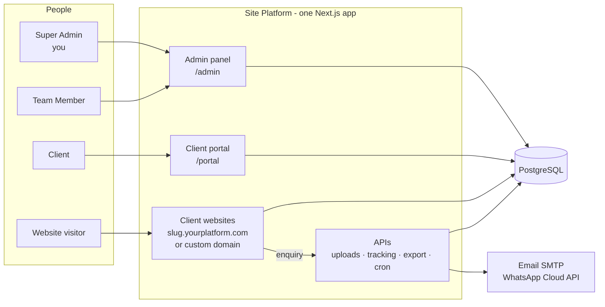

**Key idea:** a website is not code — it is a *configuration* stored in the database:

```
Website = module (School / University / Company / Shop)
        + enabled sections (which parts are switched on)
        + theme (colours, fonts, layout style)
        + content (text, images, lists)
        + automation settings (who gets alerts, auto-reply text)
```

The same rendering code reads that configuration and produces a completely different website for each client.

---

## 2. Roles and what each can do

| | Super Admin (you) | Team Member | Client |
|---|---|---|---|
| Logs in to | `/admin` | `/admin` | `/portal` |
| Sees clients | **All** clients | Only clients **they created** | Only **their own** business |
| Dashboard | Platform totals, team performance, activity log | Their own totals + their limits | Their websites, views, new enquiries |
| Create clients | ✅ unlimited | ✅ up to their **max clients** limit | ❌ |
| Modules allowed | All | Only modules you allow | — |
| Sections / design / settings | ✅ | ✅ | ❌ |
| Edit website content | ✅ | ✅ | ✅ (own sites only) |
| Publish website | ✅ | Only if you allow **Can publish** | ❌ |
| Delete clients | ✅ | Only if you allow **Can delete** | ❌ |
| Automation settings | ✅ | ✅ | ❌ |
| Enquiries | All | Their clients' | Their own |
| Assign enquiries | To anyone on the team | Only to themselves | ❌ |
| Team page, activity log | ✅ | ❌ | ❌ |
| Billing | ✅ (only role) | ❌ | Views own invoices |

How the limits are enforced: every database query goes through a **scope filter** (`clientScope` / `siteScope` in `src/lib/permissions.ts`). A team member's query automatically becomes "clients where owner = me"; a client's becomes "sites where client = my business". So even if someone types another ID into the URL, they get *404 Not found*.

---

## 3. First-time setup

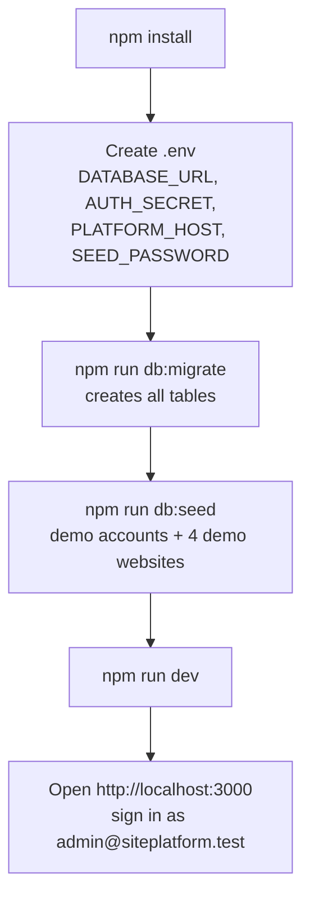

Optional settings in `.env` (see `.env.example`):
- `SMTP_*` → real emails are sent (otherwise they are only recorded).
- `WHATSAPP_*` → real WhatsApp alerts (otherwise only recorded).
- `CRON_SECRET` → protects the daily billing job.
- `UPLOAD_DIR` → where uploaded images are stored.

---

## 4. Login flow

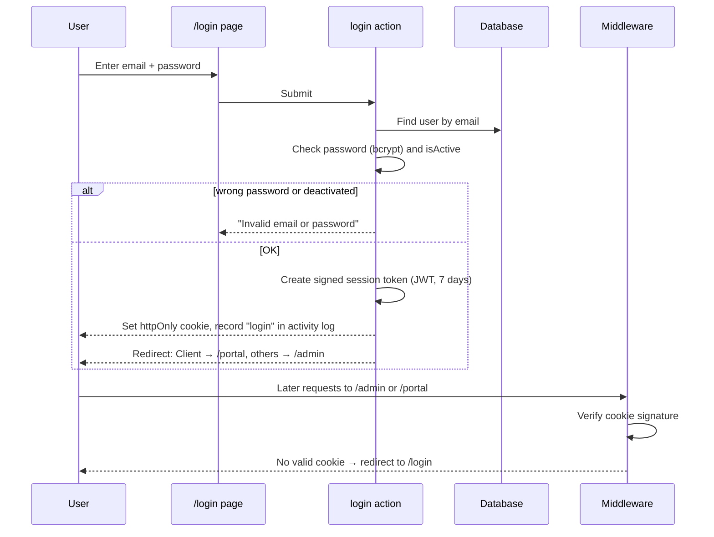

Every page also re-loads the user from the database, so if you **deactivate** a team member their next click logs them out.

---

## 5. Super Admin: building your team

1. Go to **Team → + Add member**.
2. Enter name, email, password and role:
   - **Team Member** (limited) or **Super Admin** (full access).
3. For a team member, set **Access limits**:
   - Maximum clients they can create
   - Can publish websites (yes/no)
   - Can delete clients (yes/no)
   - Which modules they may use (School, University, Company, Shop)
4. Save. They can now sign in at `/admin`.

Later you can open the member to change limits, reset the password, see their clients, or **Deactivate** them. You can also move a client to another member from the client page (**Assigned team member**).

---

## 6. Creating a client and their website

Done by the Super Admin or a Team Member: **Clients → + New client**. One form, three parts:

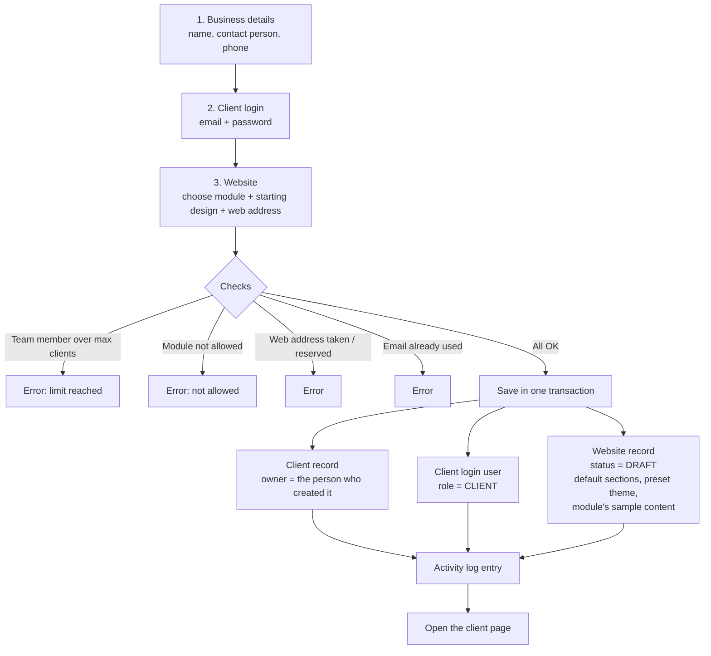

The new website already looks complete because each module ships with sample text for every section. It stays a **Draft** (not public) until it is published.

From the client page you can also:
- **Add another website** for the same client.
- **Add another login** for the client, or reset a client's password.
- Edit details and internal notes.
- (Super Admin) set the **billing plan** and see invoices.
- Delete the client (if permitted).

---

## 7. Building the website (the builder)

Open **Websites → (a site)**. The left side has tabs, the right side shows a **live preview** (desktop or mobile) that reloads after each save.

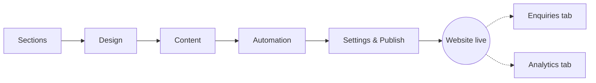

### Step 1 — Sections
Switch parts of the website on or off. Each module has its own list, for example:

| Module | Sections |
|---|---|
| School | Hero, About, Highlights, Academics, Admissions form, Faculty, Notices, Events, Gallery, Parent testimonials, Contact |
| University | Hero, About, Key numbers, Departments, Programs, Admissions form, Research, Placements, News & events, Campus gallery, Alumni, Contact |
| Company | Hero, About, Key numbers, Services, Portfolio, Team, Testimonials, Careers, Contact / quote form |
| Shop | Hero, Offers, Products, About, Gallery, Customer reviews, Contact |

Sections marked *required* (e.g. Hero, Contact) cannot be switched off.

### Step 2 — Design
- Pick a **preset** (each module has 3), or customise:
- **Colours**: primary, accent, background, section background, text
- **Fonts**: heading font and body font (10 Google Fonts)
- **Layout style**: Classic (solid header, bordered cards), Modern (gradient hero, shadows), Minimal (white space, thin lines)
- **Hero layout**: centered, or text + image side by side
- **Corners**: square → pill

The design is saved as a small JSON "theme". The website turns it into CSS variables, so one change restyles the whole site.

### Step 3 — Content
A form is generated automatically from the module definition:
- **Brand & contact details**: site name, tagline, logo, phone, email, WhatsApp number, address, footer text, Google search description.
- One panel per enabled section with its fields (title, text, images…).
- Repeating items (courses, teachers, products, notices…) can be **added, removed and re-ordered**.
- Image fields accept a URL or an **Upload** button (PNG/JPG/WEBP/GIF, max 5 MB).

On save, the server keeps only the fields the module knows about (anything else is dropped), so stored content always matches the module.

### Step 4 — Automation
What happens when someone fills a form on this website:
- Email the client ✅/❌
- Email the account manager (team member) ✅/❌
- Extra email addresses
- WhatsApp alert + number ✅/❌
- Auto-reply email to the visitor ✅/❌ with editable subject and message (`{{name}}`, `{{site}}` placeholders)

### Step 5 — Settings & Publish
- Website name, web address (subdomain), optional **custom domain**.
- **Publish** makes the website public (only Super Admin, or team members with *Can publish*). **Unpublish** turns it back into a draft.

---

## 8. How a website is served to a visitor

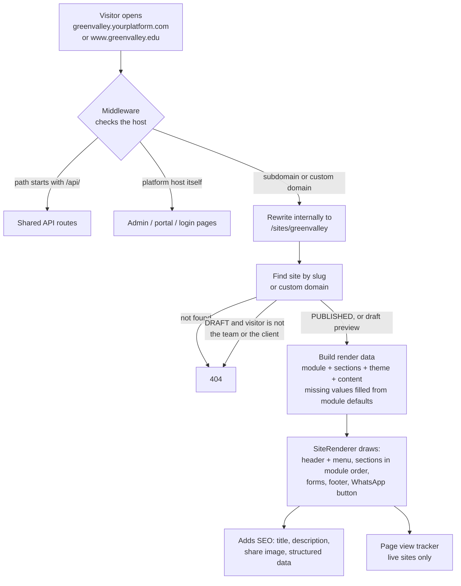

Extra per-site addresses:
- `/sitemap.xml` and `/robots.txt` — generated per site (drafts tell search engines not to index).

For production: point a wildcard DNS record `*.yourplatform.com` to the server; for a custom domain, the client adds a CNAME to your server and you enter the domain in **Settings**.

---

## 9. Visitor submits a form → automation

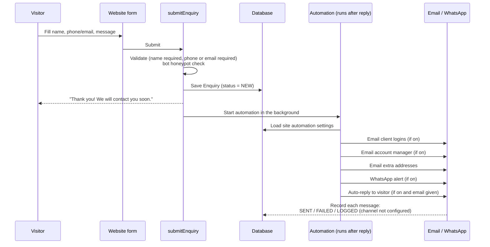

The visitor never waits for emails to be sent — automation runs after the response.

---

## 10. Handling enquiries (CRM)

Where: **Enquiries** in the admin panel (all enquiries in your scope) or in the client portal (client's own).

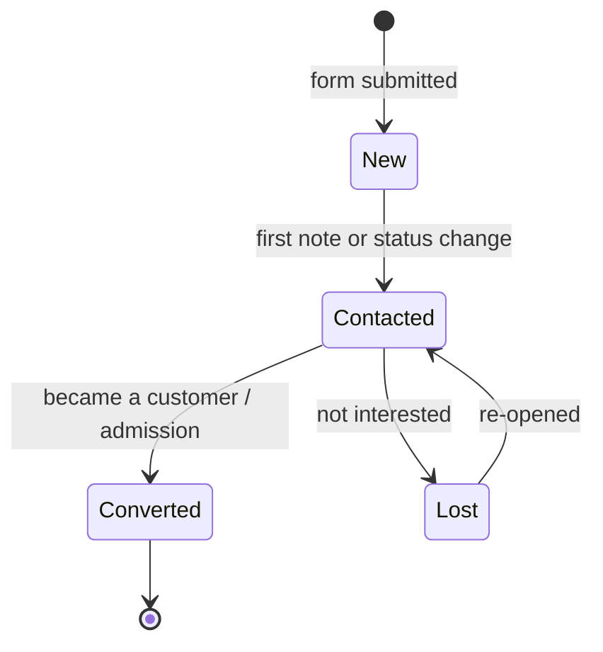

Step by step:
1. Open **Enquiries**. Filter by status tabs (New / Contacted / Converted / Lost), website, assigned person, or search by name/email/phone.
2. Change the status straight from the list, or open an enquiry.
3. On the enquiry page:
   - **Call / WhatsApp / Email** buttons.
   - **Notes & follow-ups** — adding the first note moves a *New* enquiry to *Contacted*.
   - **Assigned to** — Super Admin assigns to anyone; team members can take it themselves.
   - **Automated messages** — shows every alert/auto-reply and whether it was sent.
4. **Export CSV** downloads exactly the filtered list (and only what you're allowed to see).

---

## 11. Client portal flow

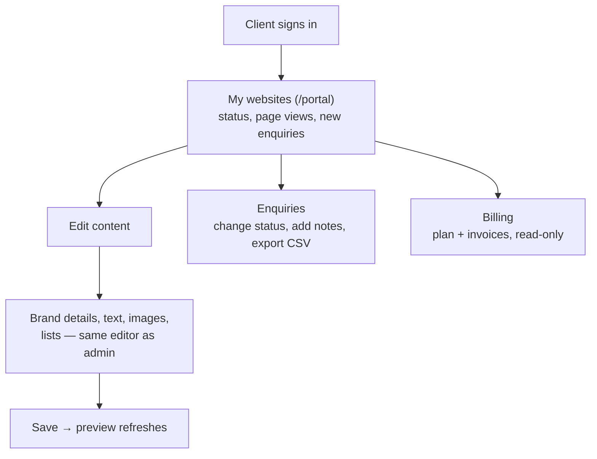

Clients **cannot** change sections, design, web address, automation or publish status — they only update their own content. Those requests go to their account manager.

---

## 12. Visitor analytics

1. When a page of a **published** site loads, a tiny script sends one "page view" to `/api/track`.
2. Builder previews (`?preview=1`) and bots are ignored.
3. No cookies and no IP addresses are stored. Unique visitors are counted with a one-way hash of (IP + browser + today's date + secret) that changes every day.
4. Results appear in:
   - Builder → **Analytics** tab (views, unique visitors, daily chart, top referrers — last 30 days)
   - Admin dashboard (page views across your sites)
   - Client portal (views per website)

---

## 13. Billing flow (Super Admin only)

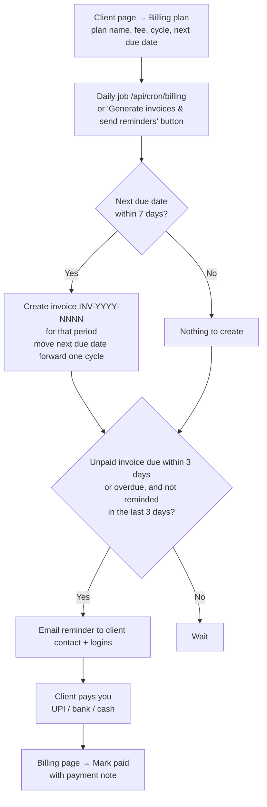

The **Billing** page shows: recurring revenue per month, collected this month, outstanding, overdue, due in 7 days, and the invoice list with **Mark paid / Remind / Cancel**. One-off invoices (e.g. setup fee) can be created on the client page. Clients see their invoices under **Billing** in the portal.

> Online payment collection is not built in yet — invoices are tracked and marked paid manually.

---

## 14. Data model

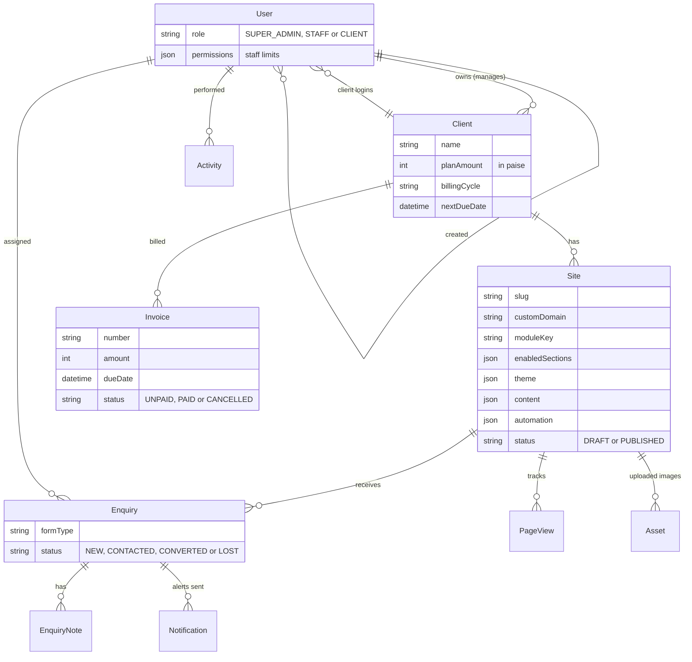

Structured data (users, clients, permissions, invoices) uses normal tables with relations; flexible per-module data (theme, content, automation) is stored as **JSONB** on the `Site` row.

---

## 15. Where each step lives in the code

| Flow | Files |
|---|---|
| Host routing (subdomain / custom domain), login guard | `src/middleware.ts` |
| Login, session cookie | `src/app/login/`, `src/app/actions/auth.ts`, `src/lib/session.ts`, `src/lib/auth.ts` |
| Roles and limits | `src/lib/permissions.ts` |
| Dashboard | `src/app/admin/page.tsx` |
| Clients, team, client logins | `src/app/admin/clients/`, `src/app/admin/team/`, `src/app/actions/admin.ts` |
| Builder (sections, design, content, automation, settings) | `src/components/builder/`, `src/app/admin/sites/[id]/`, `src/app/actions/site.ts` |
| Module definitions | `src/modules/*.ts`, `src/modules/registry.ts` |
| Website rendering | `src/app/sites/[site]/`, `src/components/site/SiteRenderer.tsx` |
| Public forms + automation | `src/app/actions/enquiry.ts`, `src/lib/enquiry-automation.ts`, `src/lib/notify.ts`, `src/lib/automation.ts` |
| Enquiry CRM + CSV | `src/app/admin/enquiries/`, `src/app/portal/enquiries/`, `src/components/crm/`, `src/app/actions/crm.ts`, `src/app/api/enquiries/export/` |
| Image uploads | `src/app/api/uploads/`, `src/lib/uploads.ts` |
| Analytics | `src/app/api/track/`, `src/components/site/PageViewTracker.tsx`, `src/lib/analytics.ts` |
| Billing | `src/app/admin/billing/`, `src/app/portal/billing/`, `src/lib/billing.ts`, `src/app/actions/billing.ts`, `src/app/api/cron/billing/` |
| Client portal | `src/app/portal/` |
| Database schema / demo data | `prisma/schema.prisma`, `prisma/seed.ts` |

---

## 16. Adding a new industry module (e.g. Hospital)

1. Create `src/modules/hospital.ts` exporting a `ModuleDef`:
   - `sections`: reuse existing kinds — `hero`, `about`, `stats`, `cards`, `list`, `gallery`, `testimonials`, `products`, `contact` — with labels and sample content.
   - `presets`: 2–3 design presets.
   - `defaultBrand`: sample name, phone, address.
2. Add it to `MODULES` in `src/modules/registry.ts`.

It then appears automatically in **New client**, the builder, team permissions and the content editor — no other changes needed.
