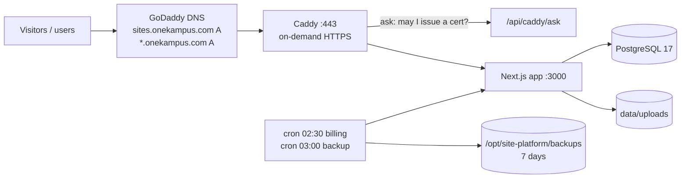

# Deployment: AWS Lightsail

How Site Platform runs in production, how to deploy updates, and how to restore from a backup.

## 1. What's running

| Item | Value |
|---|---|
| AWS account / region | `onekampus` profile, `ap-south-1` (Mumbai) |
| Server | Lightsail instance `site-platform`, Ubuntu 24.04, 1 GB RAM + 2 GB swap ($7/month) |
| Static IP | `site-platform-ip` → **16.4.19.238** |
| SSH | `ssh -i ~/.ssh/site-platform-lightsail.pem ubuntu@16.4.19.238` |
| App folder | `/opt/site-platform/deploy` (compose, Caddyfile, scripts, `.env`, `data/`) |
| Admin panel | **https://sites.onekampus.com** |
| Client websites | **https://&lt;slug&gt;.onekampus.com**, e.g. https://advera.onekampus.com |
| Client custom domains | Any domain saved in a site's **Settings → Custom domain** whose DNS points at the static IP |
| Snapshots | Lightsail automatic daily snapshot at 21:00 UTC (02:30 IST), kept 7 days |



## 2. Prerequisites (one time)

| # | What | Status |
|---|---|---|
| 1 | AWS account with the Lightsail server, static IP and ports 80/443 open | ✅ done |
| 2 | **GoDaddy DNS:** `A  sites  → 16.4.19.238` | you add it |
| 3 | **GoDaddy DNS:** `A  *  → 16.4.19.238` (wildcard for every client site) | you add it |
| 4 | Server prepared with `deploy/server-setup.sh` (swap, Docker, secrets, cron) | ✅ done |
| 5 | Optional: SMTP details in `/opt/site-platform/deploy/.env` for real alert emails | later |
| 6 | Optional: off-site S3 backups (see §6) | later |

Existing records (`www`, `admin`, `music`, `music-admin`, `music-api`, the apex and the ACM `_…` CNAMEs) stay as they are. A specific DNS record always wins over the `*` wildcard. Those names are also **reserved**, so no client can use them as a web address (`RESERVED_SUBDOMAINS` in `.env`, plus the built-in list in `src/lib/hosts.ts`).

## 3. Configuration (`/opt/site-platform/deploy/.env`)

Generated by `server-setup.sh` with random secrets. Never commit it, and never paste it in chat.

| Key | Meaning |
|---|---|
| `POSTGRES_PASSWORD` | Database password (used to build `DATABASE_URL` in compose) |
| `AUTH_SECRET` | Signs login sessions. Changing it signs everyone out. |
| `CRON_SECRET` | Protects `/api/cron/billing` |
| `PLATFORM_HOST` | `sites.onekampus.com` |
| `SITE_BASE_DOMAIN` | `onekampus.com`, so sites are `<slug>.onekampus.com` |
| `RESERVED_SUBDOMAINS` | `music,music-admin,music-api,admin,www,api` |
| `SMTP_*`, `WHATSAPP_*` | Optional. Until set, alerts are saved as **LOGGED**. |

After editing `.env`, restart the app:
```bash
ssh -i ~/.ssh/site-platform-lightsail.pem ubuntu@16.4.19.238 "cd /opt/site-platform/deploy && docker compose up -d app"
```

## 4. Deploying an update

From the project folder on your Mac, after merging to `main`:

```bash
DEPLOY_HOST=ubuntu@16.4.19.238 deploy/deploy.sh
```

It does the following:
1. Builds the app **on your Mac** (`next build`, standalone output, into `.next-prod`), so the 1 GB server never runs a heavy build.
2. Uploads the bundle and the `deploy/` folder. The server's `.env` and `data/` are never touched.
3. On the server: builds the small runtime image, runs `prisma migrate deploy`, and restarts the containers.

## 5. First sign-in

The data was copied from the local database. Every account that still used the local seed password was given a **new random password** during the copy. To read them:

```bash
ssh -i ~/.ssh/site-platform-lightsail.pem ubuntu@16.4.19.238 "cat /opt/site-platform/CREDENTIALS.txt"
```

Sign in at https://sites.onekampus.com/login, then change the passwords. Delete the file once you've saved them:

```bash
ssh -i ~/.ssh/site-platform-lightsail.pem ubuntu@16.4.19.238 "rm /opt/site-platform/CREDENTIALS.txt"
```

## 6. Backups and restore

- **Nightly at 03:00 UTC:** `deploy/backup.sh` writes `db.dump` and `uploads.tgz` to `/opt/site-platform/backups/<timestamp>/` and keeps 7 days.
- **Daily Lightsail snapshot** of the whole server, kept 7 days. To restore, create a new instance from a snapshot in the Lightsail console, then move the static IP to it.
- **Optional off-site copy:** create an S3 bucket and an IAM user that can only `s3:PutObject` to it. Put its key in `/opt/site-platform/deploy/.aws-backup` (profile `[backup]`) and add `BACKUP_BUCKET=<bucket>` to `.env`. `backup.sh` then also uploads each backup.

Restore the database from a dump:
```bash
cd /opt/site-platform/deploy
docker compose stop app
docker compose exec -T db pg_restore -U siteplatform -d site_platform --clean --if-exists --no-owner < ../backups/<timestamp>/db.dump
tar -xzf ../backups/<timestamp>/uploads.tgz -C data && sudo chown -R 1000:1000 data/uploads
docker compose start app
```

## 7. Adding a client's own domain

1. In the builder: **Settings → Custom domain**, e.g. `www.adveraadvertising.com` → Save.
2. At the client's DNS provider: an `A` record for the domain (and `www`) → `16.4.19.238`.
3. On the first visit, Caddy asks `/api/caddy/ask`, which approves the domain because a site uses it, and gets an HTTPS certificate automatically.

## 8. Useful commands

```bash
# status / logs
ssh -i ~/.ssh/site-platform-lightsail.pem ubuntu@16.4.19.238 "cd /opt/site-platform/deploy && docker compose ps && docker compose logs --tail 50 app"
# run the billing job now
ssh -i ~/.ssh/site-platform-lightsail.pem ubuntu@16.4.19.238 /opt/site-platform/deploy/cron-billing.sh
# run a backup now
ssh -i ~/.ssh/site-platform-lightsail.pem ubuntu@16.4.19.238 /opt/site-platform/deploy/backup.sh
```

## 9. Cost

| Item | Monthly |
|---|---|
| Lightsail micro (1 GB, 40 GB SSD, 2 TB transfer) incl. static IP | $7 |
| Automatic snapshots (incremental) | ~$1–2 |
| Let's Encrypt certificates | free |
| **Total** | **≈ $8–9 (≈ ₹700–750)** |

When the platform outgrows 1 GB (slow pages, swap in use), resize by taking a snapshot and creating a 2 GB instance ($12) from it, then move the static IP.
