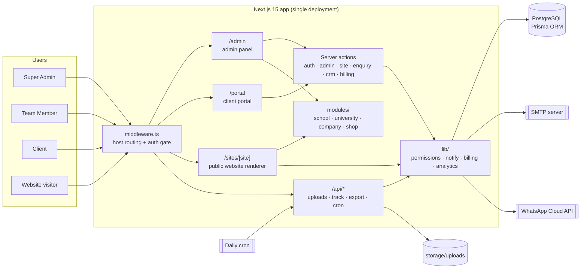
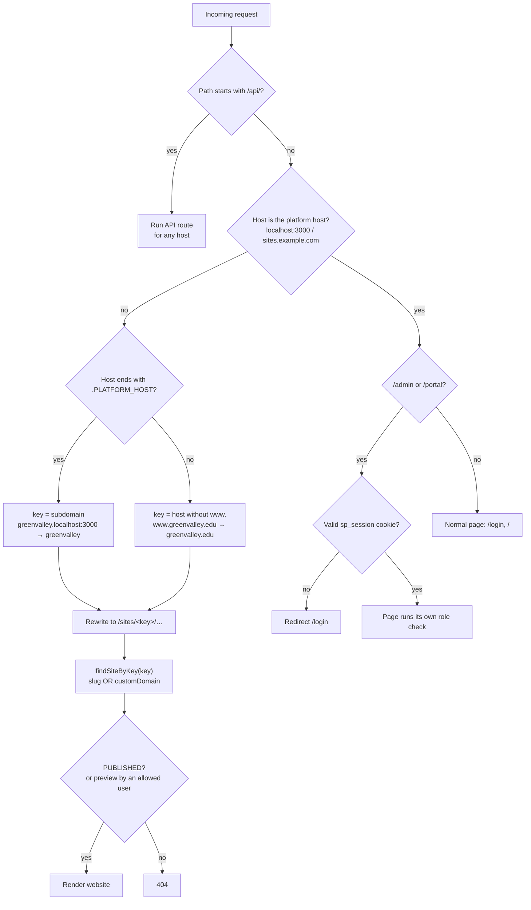
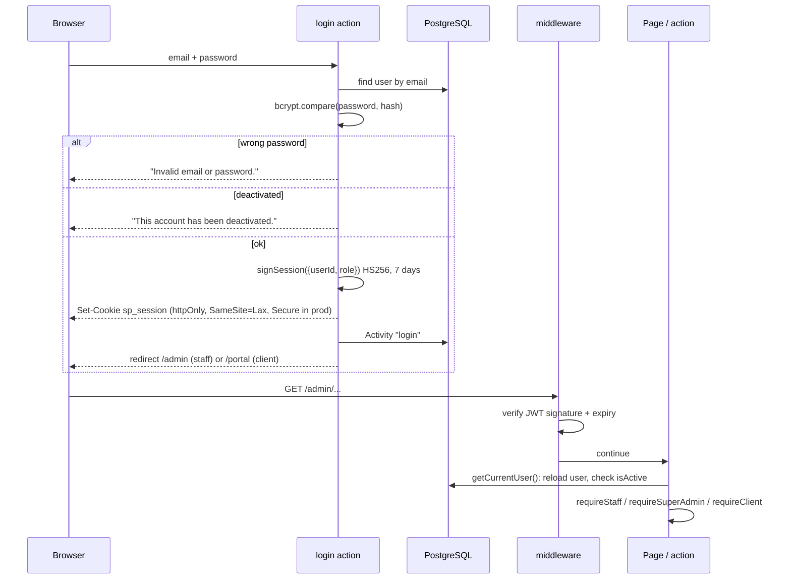
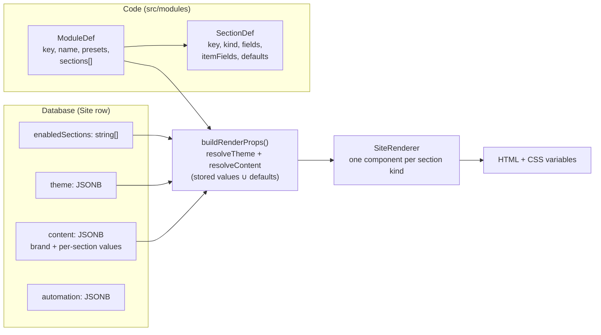
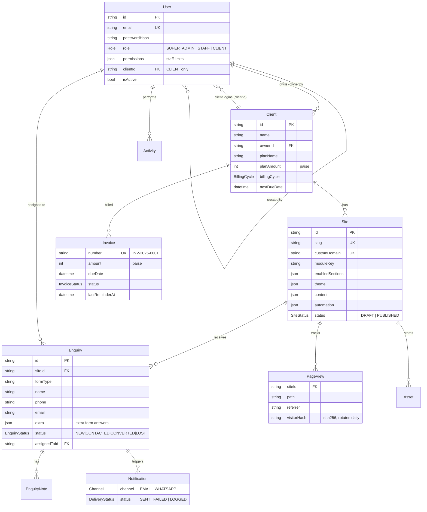
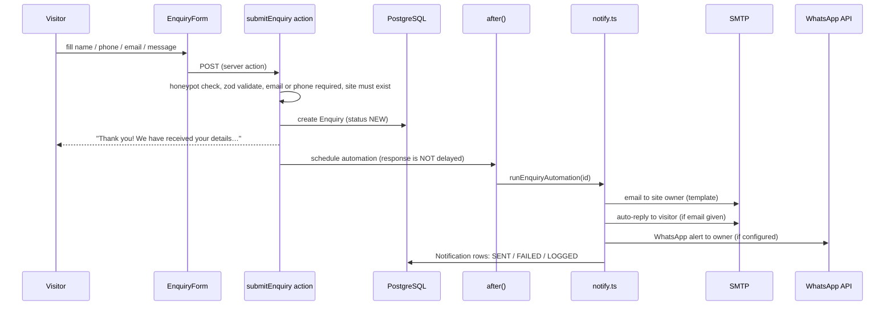
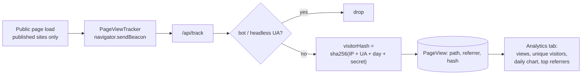
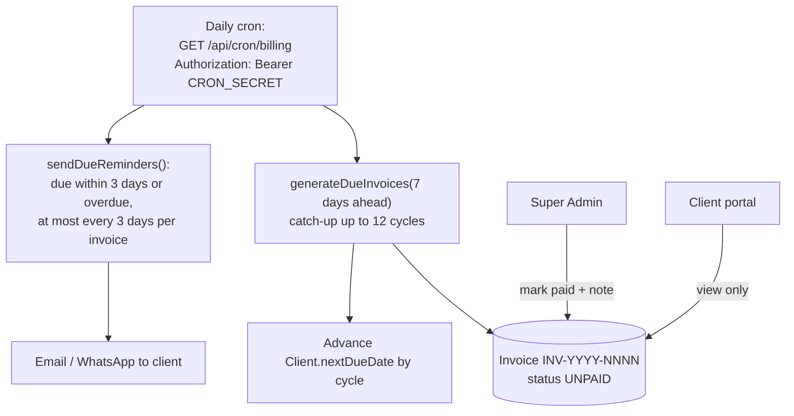
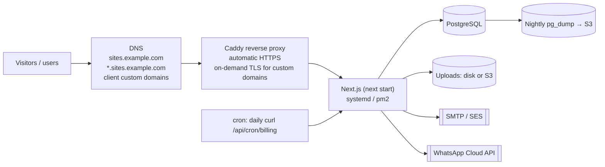

# Site Platform: System Design

This document explains **how the platform is built**: its architecture, components, data model, security, and how it is deployed and scaled.

- For **what each user does, step by step, with screenshots**, see [APPLICATION_FLOW.md](./APPLICATION_FLOW.md).
- All screenshots live in [`docs/screenshots/`](./screenshots).

---

## 1. Goals and requirements

### Functional

| # | Requirement |
|---|---|
| F1 | One codebase generates many client websites from **industry modules**: School, University, Company and Shop. |
| F2 | Each module has many **sections** that can be turned on or off, reordered and edited. |
| F3 | Each website has its own **theme**: colours, fonts, corner radius, style and hero layout. |
| F4 | There are **three roles** (Super Admin, Team Member and Client), each with strict data boundaries. |
| F5 | The Super Admin sets per-member **limits** for the team: max clients, publish right, delete right and allowed modules. |
| F6 | Each website is served on a **subdomain** (`slug.platform`) or the client's **custom domain**. |
| F7 | Visitor **enquiries** go to a CRM and trigger **email and WhatsApp** alerts. |
| F8 | Clients edit only **their own** website content, enquiries and invoices. |
| F9 | The platform includes **image uploads**, **SEO** (meta tags, JSON-LD, sitemap, robots), **visitor analytics** and a **billing tracker** with reminders. |

### Non-functional

| # | Requirement | How it is met |
|---|---|---|
| N1 | **Tenant isolation:** no user sees another tenant's data. | Every query goes through `clientScope` / `siteScope` / `enquiryWhere`. |
| N2 | **Adding a new industry is cheap.** | A module is one TypeScript file with no new tables or pages. |
| N3 | **Fast public sites.** | Server-rendered HTML, CSS variables for theming and no client-side framework on the site except tiny islands. |
| N4 | **Privacy.** | Analytics store no IPs or cookies, only a daily-rotating hash. |
| N5 | **Low cost.** | A single Next.js process and one PostgreSQL database run the platform and every client website. |

---

## 2. High-level architecture



**Why one deployment?** The admin panel, the client portal and every client website are the same Next.js app. The middleware decides which part answers a request by looking at the **host name**. There is nothing to deploy per client, and a new website exists the moment its database row is created.

### Tech stack

| Layer | Choice | Why |
|---|---|---|
| Framework | **Next.js 15** (App Router, React 19, server actions) | Server rendering for SEO, a single codebase for the panel and the sites, no separate API layer needed |
| Language | TypeScript | Module definitions and theme types are checked at build time |
| Styling | Tailwind v4 for the panel, CSS variables for the sites | Site themes change at runtime without rebuilding CSS |
| Database | **PostgreSQL** + Prisma 6 | Relational integrity for roles, clients and invoices; JSONB for flexible content |
| Auth | Custom JWT (`jose`, HS256) + bcrypt | Small and edge-safe, so it can run in middleware |
| Email | nodemailer (SMTP) | Works with any provider (SES, Gmail, Zoho…) |
| WhatsApp | Meta WhatsApp Cloud API | Official API, used for alerts |
| Validation | zod | Validates server action input |

---

## 3. Request routing (multi-tenancy)



Key points:
- The **rewrite is internal**, so the visitor's address bar keeps showing `greenvalley.edu`.
- `/api/*` is shared by every host. That's how a site can call `/api/track` and `/api/uploads/...` on its own domain.
- The middleware only checks that a session **exists**. The **role and ownership** checks happen in each page and action, against the database (see §5).

---

## 4. Authentication



- **Passwords:** bcrypt hashes only, never stored or logged in plain text.
- **Instant lock-out:** the JWT only holds `userId` and `role`. On every request, `getCurrentUser()` reloads the user and rejects deactivated accounts, so deactivating someone takes effect on their next click even though their cookie is still valid.
- **Logout** deletes the cookie.

Screenshots: [login](./screenshots/01-public/01-login.png), [wrong password](./screenshots/01-public/02-login-wrong-password.png), [deactivated](./screenshots/01-public/03-login-deactivated.png).

---

## 5. Authorisation (roles and permissions)

### 5.1 Three layers of defence

| Layer | Where | What it stops |
|---|---|---|
| 1. Session gate | `src/middleware.ts` | Anyone signed out reaching `/admin` or `/portal` |
| 2. Role gate | `requireStaff()`, `requireSuperAdmin()`, `requireClient()` in `src/lib/auth.ts` | A client opening `/admin`, or a team member opening Team, Activity or Billing |
| 3. Row scope | `clientScope()`, `siteScope()`, `enquiryWhere()` in `src/lib/permissions.ts` and `src/lib/crm.ts` | Opening **another tenant's** client, site, enquiry or invoice by guessing an ID. The result is **404**, so the record's existence isn't revealed. |

Every **server action** repeats layers 2 and 3. Hiding a button in the UI is never the only protection.

### 5.2 Scope rules

```ts
clientScope(user):
  SUPER_ADMIN → {}                       // everything
  STAFF       → { ownerId: user.id }     // clients they own
  CLIENT      → { id: user.clientId }    // only their own client record

siteScope(user)  → sites whose client is inside clientScope(user)
```

### 5.3 Team member limits (stored in `User.permissions` JSONB)

| Field | Meaning | Enforced in |
|---|---|---|
| `maxClients` | How many clients they may own | `createClient` action, which shows "You have reached your limit…" |
| `canPublish` | Whether they may publish or unpublish websites | `setPublished` action; the button is disabled in the builder |
| `canDeleteClients` | Whether they may delete a client | `deleteClient` action; the button is hidden |
| `allowedModules` | Which industry modules they may use | Module picker and `createClient` / `addSite` actions |

### 5.4 Permission matrix

| Capability | Super Admin | Team Member | Client |
|---|:-:|:-:|:-:|
| Platform dashboard with global stats | ✅ | ⚠️ own numbers only | ❌ |
| See all clients | ✅ | ⚠️ only clients they own | ❌ |
| Create client | ✅ unlimited | ⚠️ up to `maxClients` | ❌ |
| Choose any module | ✅ | ⚠️ `allowedModules` only | ❌ |
| Reassign a client to another member | ✅ | ❌ | ❌ |
| Delete client | ✅ | ⚠️ if `canDeleteClients` | ❌ |
| Create client logins | ✅ | ✅ own clients | ❌ |
| Website builder: sections, design, automation, settings | ✅ | ✅ own clients | ❌ |
| Edit website **content** (text and images) | ✅ | ✅ own clients | ✅ own site |
| Publish or unpublish | ✅ | ⚠️ if `canPublish` | ❌ |
| Upload images | ✅ | ✅ own clients' sites | ✅ own site |
| See and manage enquiries | ✅ all | ✅ own clients | ✅ own site |
| Assign enquiries | ✅ to anyone on the team | ⚠️ only to themselves | ❌ |
| Export enquiries as CSV | ✅ all | ✅ own clients | ✅ own site |
| Website analytics | ✅ full Analytics tab | ✅ own clients | ⚠️ 30-day view count on portal home |
| Team management | ✅ | ❌ redirected | ❌ |
| Activity log | ✅ | ❌ redirected | ❌ |
| Billing: plans, invoices, mark paid | ✅ | ❌ redirected | ⚠️ view own invoices |
| Open `/admin` at all | ✅ | ✅ | ❌ redirected to `/portal` |

The blocked pages, limits and scoped lists are shown with screenshots in [APPLICATION_FLOW.md §17](./APPLICATION_FLOW.md#17-roles-and-permissions-proven-with-screenshots).

---

## 6. Module and theme engine

A **website is configuration, not code**. The renderer takes a module definition and the site's stored JSON and produces the page.



- **Section kinds** (the shared building blocks): `hero`, `about`, `stats`, `cards`, `list`, `gallery`, `testimonials`, `products`, `faq`, `contact`.
- **Section order is per site.** `enabledSections` is an ordered list. The renderer and the content editor follow it, and the builder's Sections tab has ↑ ↓ controls.
- **Extra form questions.** A `contact` section can declare `formFields` (`text`, `url` or `select`). A `select` can take its options from another section's item titles (`optionsFromSection`), which is how the Company form's "Service interested in" list follows the site's own services. Answers are stored in `Enquiry.extra` as `[{label, value}]`. The server only keeps questions defined for that form.
- **Modules** combine these kinds with their own labels, fields and default text. For example, the University module turns `cards` into "Departments", "Programs" and "Research".
- **Defaults merge:** content saved in the database overrides the defaults field by field. A new site therefore looks complete immediately, and adding a section later never breaks existing sites.
- **Theme to CSS variables:** `--primary`, `--secondary`, `--bg`, `--surface`, `--text`, `--radius`, `--heading-font` and `--body-font`. The style (`classic`, `modern` or `minimal`) is a class on the root. Fonts load from Google Fonts. Card and image radius is capped at 24px, so "Pill" never makes photos oval.
- **Adding an industry** (e.g. Hospital) means writing one file `src/modules/hospital.ts` and adding it to `registry.ts`. No migration is needed.

| Module | Sections |
|---|---|
| School | hero, about, highlights, academics, admissions, faculty, notices, events, gallery, testimonials, contact |
| University | hero, about, stats, departments, programs, admissions, research, placements, events, gallery, testimonials, contact |
| Company | hero, about, stats, services, portfolio, team, testimonials, whyus, faq, careers, contact |
| Shop | hero, offers, products, about, gallery, testimonials, contact |

---

## 7. Data model



**Design choices**
- **Relational where it matters.** Ownership, roles, invoices and enquiries are proper tables with foreign keys and cascades. Deleting a client removes its sites, logins, enquiries and invoices.
- **JSONB where it varies.** `theme`, `content`, `enabledSections`, `automation` and `permissions` differ per module and change often. Storing them as JSONB avoids a migration for every new section.
- **Money in paise.** Amounts are stored as integers, so there are no floating-point rounding errors.
- **Indexes** on `ownerId`, `siteId`, `status` and `createdAt` support the scoped list queries.

Migrations live in `prisma/migrations/`: `init`, `phase2_automation_crm_uploads`, `phase3_billing_analytics` and `enquiry_extra_fields`.

---

## 8. Enquiry and automation pipeline



- `after()` from `next/server` runs the alerts **after the response is sent**, so the visitor never waits for SMTP or WhatsApp.
- If SMTP or WhatsApp isn't configured, the message is saved as **LOGGED** and nothing is lost. The same table backs the "Notifications" list on the enquiry page.
- The templates and the on/off switch for each channel are set per site in the builder's **Automation** tab.

---

## 9. Uploads

| Rule | Value |
|---|---|
| Allowed | PNG, JPEG, WebP and GIF, **detected from the file's magic bytes** rather than its extension |
| Blocked | SVG (it can carry scripts) and anything else (HTTP 415) |
| Max size | 5 MB |
| Who | Signed-in users, only for sites inside their `siteScope` (otherwise 404); anonymous users get 401 |
| Stored | `storage/uploads/<id>.<ext>` on disk (git-ignored), with a row in `Asset` |
| Served | `/api/uploads/[id]` with the stored content type and `X-Content-Type-Options: nosniff` |

---

## 10. Analytics



The IP address is **never stored**. The hash includes today's date, so the same visitor can't be followed across days. No cookies are used.

---

## 11. Billing



- Cycles are **MONTHLY, QUARTERLY or YEARLY**.
- **Idempotent:** running the cron twice creates no duplicate invoices and sends no duplicate reminders.
- The cron endpoint returns 401 without the secret.

---

## 12. SEO

| Feature | Implementation |
|---|---|
| Title and description | `generateMetadata` in `src/app/sites/[site]/page.tsx`, built from the site's brand and hero |
| Open Graph and Twitter cards | Same, using the hero image when set |
| Canonical URL | The custom domain if set, otherwise the subdomain |
| JSON-LD | `Organization` with name, phone, email and address |
| sitemap.xml and robots.txt | Per-site route handlers under `/sites/[site]/` |
| Draft sites | 404 for the public; previews sent with `noindex` |

---

## 13. Security summary

| Threat | Mitigation |
|---|---|
| Session theft through XSS | Cookie is `httpOnly`, `SameSite=Lax` and `Secure` in production; React escapes all output |
| Cross-tenant data access (IDOR) | Row scopes on every query and action; foreign records return 404 |
| CSRF on server actions | Next.js server actions check the request origin, and the cookie is SameSite=Lax |
| Brute-force or guessed passwords | bcrypt hashing; the error message doesn't say whether the email exists |
| Malicious uploads | Magic-byte detection, no SVG, 5 MB cap, `nosniff` |
| CSV formula injection | Cells starting with `= + - @` are prefixed with `'` in the export |
| Unsafe links in content | Card button links only allow `http(s)`, `mailto:`, `tel:`, `#` and `/` |
| Enquiry spam | Hidden honeypot field `company_website`; zod length limits; email or phone required |
| Cron abuse | Bearer `CRON_SECRET` is required |
| Secrets in git | `.env*` is ignored; only `.env.example` is committed |
| Audit | `Activity` table records logins, client and site changes, publishing, and team edits |

---

## 14. Code layout

```
src/
├─ middleware.ts            host routing + session gate
├─ app/
│  ├─ login/                sign-in page
│  ├─ admin/                Super Admin + Team panel
│  ├─ portal/               Client portal
│  ├─ sites/[site]/         public website, sitemap.xml, robots.txt
│  ├─ actions/              server actions (auth, admin, site, enquiry, crm, billing)
│  └─ api/                  uploads, track, enquiries/export, cron/billing
├─ components/
│  ├─ site/                 SiteRenderer, EnquiryForm, PageViewTracker
│  ├─ builder/              SiteBuilder, ContentEditor, AnalyticsPanel
│  ├─ admin/  crm/  billing/
├─ lib/                     auth, session, permissions, notify, billing, analytics, uploads …
└─ modules/                 school, university, company, shop, shared, registry
prisma/                     schema.prisma, migrations/, seed.ts
scripts/screenshots.ts      regenerates every image in docs/screenshots
```

---

## 15. Deployment

> **Live setup:** see [DEPLOYMENT.md](./DEPLOYMENT.md) (Lightsail Mumbai, `sites.onekampus.com` + `*.onekampus.com`). The diagram below is the general design.



Steps, in order:
1. Set `.env`: `DATABASE_URL`, `AUTH_SECRET`, `PLATFORM_HOST=sites.example.com`, `CRON_SECRET`, and optionally `SMTP_*` and `WHATSAPP_*`.
2. Run `npm ci && npx prisma migrate deploy && npm run build && npm start`.
3. Create DNS records: an A record for `sites.example.com` and a wildcard `*.sites.example.com`. Each client with a custom domain points a CNAME or A record at the server.
4. Caddy's on-demand TLS issues a certificate the first time a new custom domain is visited. Its `ask` endpoint should only approve domains that exist in `Site.customDomain`.
5. Schedule a daily cron call to `/api/cron/billing` with the bearer secret.
6. Set up backups: a nightly `pg_dump`, plus the uploads folder (or move uploads to S3).

## 16. Scaling path

| Stage | Load | Change |
|---|---|---|
| Today | Up to a few hundred sites | One server running Next.js and PostgreSQL |
| Growth | Thousands of sites | Managed PostgreSQL (RDS); uploads on S3 + CloudFront; 2+ app servers behind a load balancer (stateless, since the JWT needs no shared session store) |
| Heavy traffic | Popular public sites | Cache rendered public pages (ISR / CDN), revalidated on save or publish; partition `PageView` by month or roll up daily |
| Automation volume | Many alerts | Move `after()` alerts to a queue (SQS or BullMQ) with retries |

## 17. Known limits and next steps

- Online payment collection (Razorpay or Stripe) isn't built yet. Billing currently tracks invoices and sends reminders.
- Each website is a single page; multi-page sites (separate About and Contact pages) are on the roadmap.
- Email and WhatsApp need real provider credentials before alerts go out. Until then they are **LOGGED**.
- `submitEnquiry` checks that the site exists but not that it is published. Draft sites aren't public, so this is low risk, but a status check should be added.
- More modules are planned: Hospital, Restaurant, Coaching institute and Real-estate.
